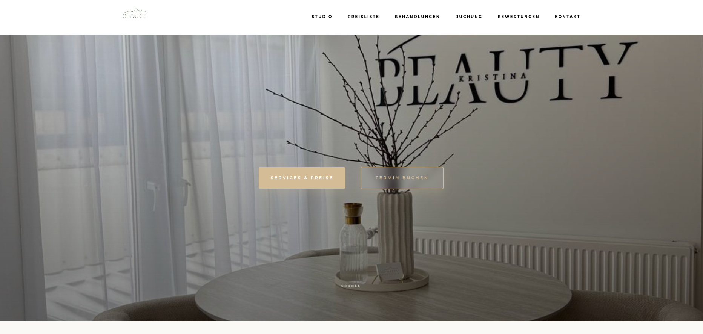

# 💄 Kristina Beauty
**Professionelle Beauty-Services & Intelligentes Buchungssystem.**

  
  

---

## 🎨 Über das Projekt
Diese Web-App ist die digitale Visitenkarte für **Kristina Beauty**. Sie dient dazu, Kunden über verschiedene Beauty-Behandlungen zu informieren und eine einfache Kontaktmöglichkeit zu bieten.
Über das integrierte Buchungssystem können Kunden Behandlungen wählen, Verfügbarkeiten im Kalender prüfen und direkt Terminanfragen senden.

### ✨ Highlights der Services:
- 👁️ **Lashes & Brows:** Wimpernlifting und Augenbrauen-Styling.
- 🧖‍♀️ **Facials:** Microneedling, Aquafacial und BB Glow.
-  **Skincare:** Individuelle Beratung für Hautpflege.
- 💄 **PMU:** Powderbrows, Aquarellips und Lippenpigmentierung.

### 🚀 Besondere Funktionen:
- 📅 **Live-Kalender:** Anzeige von belegten Terminen und automatische Feiertagssperren (Schleswig-Holstein).
- 🛒 **Warenkorb-System:** Auswahl mehrerer Behandlungen mit Live-Preisberechnung.
- 🎫 **Gutschein-Logik:** Validierung und Einlösung von Rabattcodes.
- 🗓️ **Terminkalender im Portal:** Monats-/Wochenansicht, Anfragen farbig markiert, Bestätigen/Ablehnen/Bearbeiten/Löschen, WhatsApp-Nachricht, Ton bei neuer Anfrage, .ics-Export.
- 🔒 **Admin-Dashboard:** Internes Mitarbeiterportal zur Terminverwaltung und Finanzübersicht.
- 📱 **Responsive Design:** Perfekte Bedienbarkeit auf Desktop und Smartphone.

---

## 🛠️ Tech Stack
Die Webseite wurde mit Fokus auf Performance und Ästhetik entwickelt:

  

- **Frontend:** HTML5, CSS3 (Tailwind CSS) und modernes Vanilla JavaScript.
- **Backend:** Netlify Functions (Serverless) + Netlify Blobs als dauerhafter Speicher für Termine und Gutscheine.
- **Kommunikation:** Alle E-Mails laufen über Resend (serverseitig, Netlify Functions). EmailJS wurde entfernt.
- **Deployment:** Hosting und CI/CD via Netlify.

---
## 🚀 Vorschau

  

---

## ⚙️ Einrichtung auf Netlify
Build: `npm run build` (kompiliert Tailwind → `styles.css`, läuft automatisch über `netlify.toml`).

**Umgebungsvariablen** (Site configuration → Environment variables), danach neu deployen:
| Variable | Zweck |
|---|---|
| `PORTAL_PASSWORD` | Portal-Passwort (ohne Eintrag: `beauty2026` – bitte ändern!) |
| `GMAIL_USER` | **Empfohlen, keine Domain nötig:** Gmail-Adresse als Absender, z. B. `kristina.beauty.kb@gmail.com` |
| `GMAIL_APP_PASSWORD` | 16-stelliges Google-App-Passwort (Konto → Sicherheit → 2-Schritt-Bestätigung → App-Passwörter). Ist es gesetzt, laufen alle Mails darüber; Resend dient dann als Fallback |
| `RESEND_API_KEY` | Mailversand (Bestätigung, 24h-Erinnerung, Absage, Tageszusammenfassung, Gutscheine) – ohne Key werden keine Server-Mails verschickt |
| `MAIL_FROM` | verifizierte Absenderadresse, z. B. `Kristina Beauty <termine@deine-domain.de>` |
| `OWNER_EMAIL` | Kristinas Adresse für Tageszusammenfassung + neue Anfragen (ohne Eintrag: kristina.beauty.kb@gmail.com) |
| `COPY_EMAIL` | Adresse, die von **jeder** Mail eine Kopie (BCC) bekommt – Standard `kristina.beauty.kb@gmail.com`, `off` schaltet es ab. Ausgenommen: Bestätigungscodes und Passwort-Links |
| `SITE_URL` | optional, z. B. `https://kristinabeauty.netlify.app` (für Links in Mails) |
| `NUMVERIFY_API_KEY` | optional, Telefonnummern-Prüfung |

## 💶 Zahlung
Ausschließlich **Barzahlung vor Ort**. Es gibt keine Online-Zahlung.

## 🧩 Neue Funktionen
- **Termin per Link verwalten:** `/?manage=TOKEN` (Absage/Umbuchung bis 24 h vorher). Umgebuchte Termine müssen neu bestätigt werden.
- **Feste Behandlungsdauern** (`netlify/lib/shared.js` + `extras.js`) verhindern Überlappungen; **Warteliste** meldet freie Termine per Mail.
- **Treue:** 8 Stempel = 10 € Bonus · „Freunde werben“ (5 € für beide) · Geburtstagsgutschein (10 €) · Gutscheine als PDF drucken (Portal → Gutscheine).
  Stempel werden im Portal über „✓ Erschienen / bezahlt“ vergeben.
- **Portal:** Kundenkartei (Notizen, Allergien, PMU-Einverständnis, Geburtstag), Umsatz-Diagramme, Top-Leistungen, Stammkundinnen, Warteliste.
- **Vorher/Nachher + Zertifikate:** Bilder als WebP in `gallery/` ablegen und in `gallery.json` eintragen.
- **Instagram-Feed im Footer:** Elfsight-Instagram-ID in `extras.js` (`KB.instagramWidgetId`) eintragen.
- **Cookie-Banner:** Google-Bewertungen, Instagram und TikTok laden erst nach Zustimmung.
- **Kunden-Konto** (Menü „Konto“): Registrieren/Anmelden mit E-Mail + Passwort + 6-stelligem E-Mail-Code (5 Min gültig, neuer Code nach 30 Sek.; braucht `RESEND_API_KEY`), Buchungsstatus (angefragt/angenommen/abgelehnt), Daten ändern, Profilbild, Nachrichten an Kristina (Antworten im Portal), Passwort vergessen per Mail (braucht `RESEND_API_KEY`). Angemeldet gebuchte Termine werden automatisch dem Konto zugeordnet; Buchen ohne Konto bleibt möglich.
- **Portal → Konten:** Account-Name + Passwort der Mitarbeiter ändern, Kundenkonten ansehen, Profil zurücksetzen (entfernt Bild/Namen und sperrt Bild-Upload), Konto sperren/löschen, Passwort zurücksetzen, Kundennachrichten beantworten. Optional: `SESSION_SECRET` (sonst automatisch erzeugt).
- **Community (Konto → Tab „Community“):** Nur für angemeldete Kundenkonten.
  - **Menü:** „Community“ steht in der Navigation oben (PC) und im Burger-Menü (Handy), auch als Tab im Konto.
  - **Profil bearbeiten** (Button im Konto und im Community-Profil): Profilbild, Name, Bio und Social-Media-Links (Instagram, TikTok, Facebook, YouTube, Website). Es werden nur https-Links der jeweiligen Plattform gespeichert. „Meine Daten“ enthält nur noch private Angaben (Telefon, Geburtstag).
  - **Profil teilen:** Button „Teilen“ im Profil → Link `https://deine-seite/?profile=<id>` (Teilen-Menü des Handys oder in die Zwischenablage). Wer den Link öffnet, meldet sich an und landet direkt auf dem Profil. Die ID ist ein HMAC aus der Konto-ID, enthält also keine E-Mail.
  - **Live-Sync:** Feed, Likes, Beauty-Zähler und Profile aktualisieren sich alle 20 s und beim Zurückkehren in die App; Änderungen am Konto (Bild, Bio, Sperren) synchronisieren sich zwischen Geräten/Tabs. Neue Beiträge erscheinen oben (beim Lesen als „neue Beiträge“-Hinweis).
  - **Posts:** Bild + Beschreibung, **max. 5 Hashtags pro Post** (Zähler im Editor, Server prüft ebenfalls). Max. 10 Posts pro Stunde, eigene Posts löschbar.
  - **Liken** per Herz · **Beautys** statt „Follower“: „Beauty folgen“ / „Folge ich“, Feed „Meine Beautys“ und „Entdecken“.
  - **Suche:** Posts (Text oder `#Hashtag`) und Leute (Name/Bio). Hashtags in Beschreibungen sind anklickbar.
  - **Öffentlich sichtbar** (für angemeldete Kundinnen) sind nur Name, Profilbild, Bio, Links und Posts – nie E-Mail oder Telefon.
  - **Automatischer Filter** (`isForbidden` in `netlify/lib/shared.js`): Bio, Links, Namen, Captions und Hashtags mit Nazi-/rechtsextremen Begriffen werden nicht gespeichert (erkennt auch Schreibweisen wie „N4zi“ oder „sieg heil“). Die Wortlisten dort bei Bedarf erweitern.
  - **Portal → Konten:** „Bio löschen“ (entfernt Bio + Links und sperrt weitere Änderungen) / „Bio freigeben“; „Profil zurücksetzen“ löscht jetzt auch Bio + Links.
  - **Portal → Community:** alle neuesten Posts mit Bild, Autorin, Likes – unpassende Posts mit einem Klick löschen. Beim Löschen/Sperren eines Kontos werden dessen Posts mit entfernt (Löschen).
  - Neue Dateien: `netlify/functions/social.js`, `social.js`, `portal_social.js` (Daten in Netlify Blobs: Store `social`).
- **PWA, Dark Mode, DE/EN/RU** (Rechtstexte und lange Behandlungstexte bleiben deutsch).

---
Website von Nicominecith

- **Community-Kommentare:** Pro Post ein- und ausschaltbar (Schalter beim Posten und am Post); der Post-Besitzer kann jeden Kommentar löschen, jeder seine eigenen.

---
## 🆕 Update (Oktober 2026)
- **Handy:** Profilbild im Konto bleibt rund (CSS-Fix `.kba-head>.kba-av`).
- **Tablet:** Navigation wechselt bis 1179 px auf das Burger-Menü (2 Spalten, scrollbar); Mitarbeiterportal hat eigene Tablet-Layouts (`portal_theme.css`).
- **Konto:** Buttons „Mein Profil“/„Community“ oben entfernt (liegen im Menü; „Konto“ öffnet immer das Profil). **Chat beenden** löscht den Verlauf für die Kundin (`end_chat`), das Studio sieht den Hinweis „Chat vom Kunden beendet“.
- **Community im Instagram-Stil:** Stories-Leiste, Tab-Leiste unten, Doppeltipp = Herz, „Alle n Kommentare ansehen“, Profil mit Statistik + 3er-Raster.
- **Übersetzungen:** `i18n_more.js` (DE/EN/RU) deckt Preisliste, Behandlungen, Kalender, Konto, Community, Server-Meldungen und Datenschutz ab; dynamische Texte per Regex-Muster.
- **Datenschutz:** neu und vollständig (Konto, Community, Mails, Cookies, externe Dienste, Rechte). Bitte einmal rechtlich prüfen lassen.
- **Neu:** Roter Punkt am „Konto“-Menü bei neuer Antwort von Kristina · Termin als .ics in den Handy-Kalender (mit Erinnerung) · „Nochmal buchen“ · Community-Beiträge melden (Mail an Kristina).
- **Mails:** Design der Buchungsanfrage-Mail für alle Status. Bei **Annehmen** → „Angenommen“, bei **Ablehnen** → eigene „Abgelehnt“-Mail (vorher fälschlich „abgesagt“).

---
## 🎵 Update: Musik im Community-Feed
- **Musikstelle wählen:** Nach dem Auswählen eines Songs erscheint ein Schieberegler – der 15-Sekunden-Ausschnitt der 30-Sekunden-Vorschau lässt sich frei setzen und direkt vorhören. Gespeichert wird `music.start` (0–15 s, Server prüft den Wert).
- **Autoplay wie Instagram:** Der Post, der beim Scrollen im Blick ist (≥ 60 % sichtbar), spielt automatisch; beim Wegscrollen, App-Wechsel oder Sperren des Handys pausiert die Musik.
- **Ton an/aus:** Symbol in der Bildmitte (Einzeltipp aufs Bild = Ton an/aus, Doppeltipp = Herz). Die Einstellung wird gemerkt (`kb_mute`).
- **iPhone & Android:** ein einziges, per erstem Tipp freigeschaltetes Audio-Element (nötig für Autoplay in Safari/Chrome), `playsinline`, Stummschaltung über `muted` statt `volume` (iOS ignoriert `volume`), Pause im Hintergrund, 44-px-Tippflächen, 16-px-Eingabefelder (kein Zoom), Safe-Area/`dvh` für Notch und Browserleisten.
- **Behandlung aus der Preisliste:** Im Composer wählt man Kategorie → Behandlung direkt aus `fullPriceListData` (index.html). Der aktuelle Preis wird am Post angezeigt und bleibt mit der Preisliste synchron.

## 🎬 Update: Videos in der Community
- **Upload:** Im Composer „Foto oder Video auswählen“. Erlaubt: **MP4/MOV/WebM, höchstens 1:30 min und 30 MB**. Längere Videos werden mit Hinweis abgelehnt (Browser prüft die Länge, der Server zusätzlich im MP4-Header und über die Größe).
- **Optimieren im Browser:** Videos über 30 MB (z. B. iPhone-Aufnahmen) und MOV-Dateien werden per Button „Video optimieren“ in Echtzeit auf max. 1280 px / ~2 MBit/s verkleinert (MediaRecorder). Dauer ≈ Länge des Videos, die App muss dabei geöffnet bleiben.
- **Speicherung:** Netlify Functions erlauben max. 6 MB pro Anfrage → Upload und Auslieferung laufen in 2-MB-Teilen (`video_init` / `video_chunk` → Blobs `v/<id>/<n>`, Metadaten `vm/<id>`). Ausgeliefert wird per HTTP-Range (206), das braucht Safari/iPhone. Titelbild = Bild des Posts (Raster, Vorschau).
- **Feed:** Videos laufen im Blick automatisch (zuerst stumm, mit Ton nach dem ersten Tipp), Einzeltipp = Ton an/aus, Doppeltipp = Herz; teilen sich die Stummschaltung mit der Musik. Videos haben keine Hintergrundmusik.
- **Aufräumen:** Löschen eines Posts, Moderation im Portal und Konto-Löschung entfernen auch die Video-Teile. Nicht fertig gepostete Uploads bleiben als `v/…`-Teile liegen (klein, bei Bedarf im Netlify-Blobs-Store `social` löschen).

## ✉️ Update: E-Mails
- **EmailJS entfernt.** Die Buchungsanfrage löst jetzt nur noch serverseitig Resend-Mails aus: Eingang an die Kundin und eine ausführliche Info an Kristina (Name, Behandlungen, Termin, Preis/Rabatt, E-Mail, Telefon, Anmerkung).
- **Kopie an Kristina.beauty.kb@gmail.com** bei jeder Mail (BCC). Bestätigungscodes und Passwort-Links bekommen bewusst keine Kopie, sonst könnte jeder mit Zugriff auf das Postfach fremde Konten übernehmen.
- **Logo:** Jede Mail zeigt das Logo (`/logo.png`) als rundes Profilbild im Kopf. Das Absender-Bild im Posteingang (Gmail/Apple Mail) lässt sich nicht per Code setzen; dafür braucht es BIMI mit eigener Domain.
- Nötig: `RESEND_API_KEY` und eine bei Resend **verifizierte Domain** in `MAIL_FROM` (z. B. `Kristina Beauty <termine@deine-domain.de>`). Mit der Test-Adresse `onboarding@resend.dev` verschickt Resend nur an die eigene Konto-Adresse.
